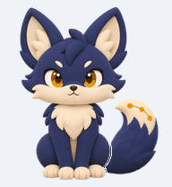
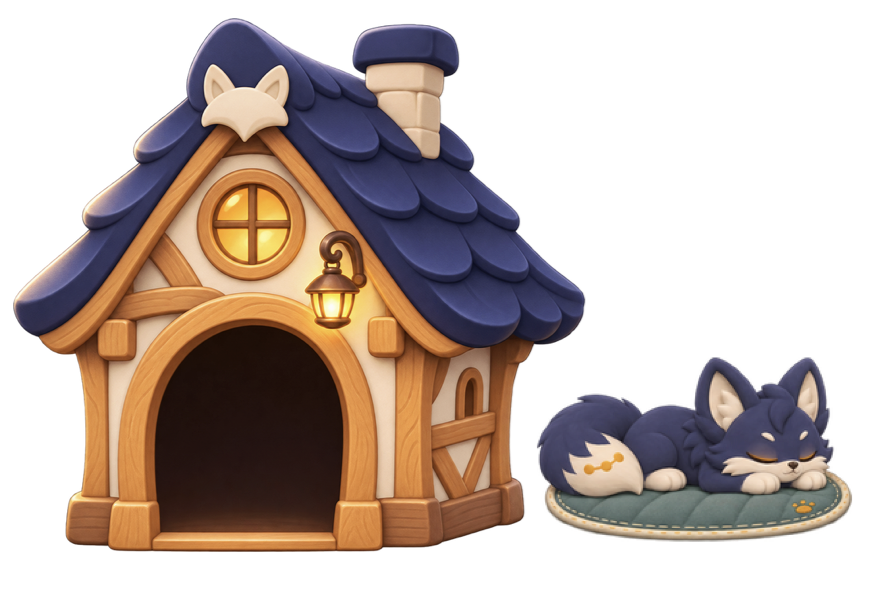
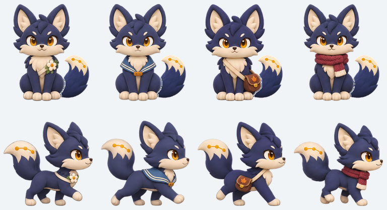
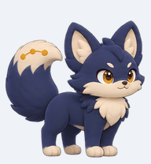
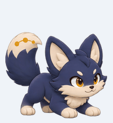
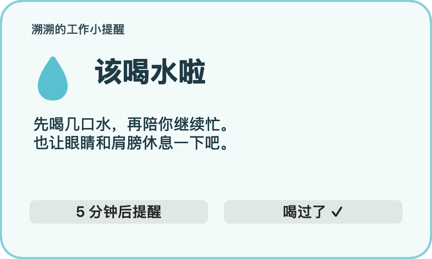

# 溯溯 Susu Desktop

一只住在 macOS 桌面上的墨蓝小狐狸。奶白脸、琥珀眼，尾尖有三颗相连的琥珀纹样。

当前版本：**2.11**。基础玩法和聊天简答均可离线使用。可选接入 OpenAI 兼容模型。



## 桌面上的生活

小房子有深蓝屋顶、暖窗和门灯，背景透明，平时自由活动时收起。菜单 →「吃喝与小窝 → 回窝拿毯子休息」会摆出房子：溯溯进屋叼出毯子，低头放下、前爪铺开，再趴下休息。单击房子或选择「收毯子回屋」后，它会收好毯子、回屋放下，再走出来；房子随之自动收起。休息期间可以直接拖动房子。



右键溯溯或点击菜单栏爪印，按「陪伴互动」「吃喝与小窝」「玩耍与行动」「学习与信件」「造型与合影」「工作与提醒」「设置与存档」进入对应子菜单。第一层保留收起道具、显示或隐藏、退出。选择「固定菜单到桌面…」可保留操作面板，点击别处仍可继续使用。回应气泡的配色和文字大小在「设置与存档 → 回应气泡」中调整。双击溯溯，或选「陪伴互动 → 和溯溯聊天」，即可在狐狸旁的输入气泡发消息和看回复。点「完整聊天」可在可缩放窗口查看历史。导入导出使用系统文件选择器。

直接发送消息即可获得本地简答。要使用大模型，点聊天气泡里的齿轮，填写服务地址、模型 ID 和服务要求的 API Key。季节外观包括春季花叶胸饰、夏季海蓝水手领、秋季枫叶小挎包和冬季针织围巾。详细操作见 [使用说明](使用说明.md)。

桌面交互道具和聊天气泡默认闲置 30 秒收起，时长可在「设置与存档」调整。在「工作与提醒 → 任务报信」可以用一句话创建待办和提醒，也可以匹配并确认执行本机授权的项目动作。

## 四季外观

「造型与合影 → 季节外观」可手动选择春、夏、秋、冬，或回到原始外观。配饰与完整身体姿态共同绘制，左右散步同步镜像；待机身体固定，只有尾巴变化。



四季外观贯穿待机、散步、跑步、伸懒腰、玩耍、叼毯、铺毯、趴卧和近看互动，也会出现在合影姿态里。

## 功能

- 待机时身体固定，只有尾巴轻轻摆动。
- 点击显示回应，拖动可自由摆放。
- 散步只沿起点高度左右移动；跑步可自由改变方向。
- 伸懒腰和玩耍动画，可手动触发，也会在自动活动时偶尔出现。
- 桌面自由活动，可部分移出屏幕，始终保留一块可见身体。
- 透明区域点击穿透；菜单栏爪印可找回、隐藏、调整大小或退出。
- 工作模式：屏幕划为 4×4 共 16 格，选择一格固定活动，可切换工作屏幕。
- 工作时用醒目的常驻卡片提醒喝水，支持 15 / 30 / 45 / 60 分钟和延后 5 分钟。
- 安静模式；记住窗口位置和偏好。

这是二维桌面版。真正的三维模型和 AR 将作为后续独立升级。

## 下载与使用

在本仓库的 **Releases** 下载已发布的安装包，或使用下方命令从源码构建当前版本。构建后打开 `溯溯.app`，本地压缩包为 `release/溯溯桌面版-2.11.zip`。

已在 Apple Silicon Mac 上验证。当前构建脚本按本机 CPU 架构编译，部署目标为 macOS 13 或更新版本；尚未完成其他硬件与系统版本的兼容验证。发布包使用本地临时签名，未进行 Apple 公证；macOS 可能需要在“系统设置 → 隐私与安全性”允许打开。

| 操作 | 效果 |
| --- | --- |
| 单击 | 显示回应气泡，身体不弹跳 |
| 拖动 | 改变位置，可部分离屏 |
| 右键 / 菜单栏爪印 | 打开控制菜单 |
| 左右散步 / 跑一圈 | 分别启动水平慢走或跑步 |
| 伸个懒腰 / 玩耍一下 | 播放对应动作，结束后恢复待机 |
| 自由活动 | 自动活动，以慢走为主；默认开启 |
| 工作模式 | 将溯溯完整限制在选定地盘；默认右下角第 16 格 |
| 工作与提醒 | 切换地盘 / 屏幕，预览网格，设置或试用喝水提醒 |
| 喝水提醒（立即体验） | 立即显示提醒卡片，无需先开启工作模式 |
| 安静模式 | 停止动画、走动与提醒 |
| 回到主屏幕 | 找回溯溯 |

## 动作与互动

右键或点击菜单栏爪印，选择「左右散步」「伸个懒腰」或「玩耍一下」。开启自由活动后也会偶尔伸懒腰或玩耍。伸懒腰约 2.9 秒，玩耍约 2.9 秒（两轮）。动作原地播放，结束后恢复原来的固定身体摇尾巴待机；拖动、安静模式、隐藏与喝水提醒会中断动作。临近屏幕边缘时先移入可见范围，再播放动作，避免姿态变化后看不到宠物；工作模式仍限制在选定地盘。




动作生成提示词见 [制作记录](Art/1.5/prompts.md)，最终素材在 `Assets/frames/stretch/` 和 `Assets/frames/play/`；提取脚本使用同一缩放比例和地面基准，运行时无需生成服务。

## 工作模式

点击菜单栏爪印或右键溯溯，在「工作与提醒」中开启「工作模式」。当前屏幕的可用区域（扣除菜单栏和 Dock）分为 4 行 × 4 列，从左上按行编号 1–16。默认使用右下角第 16 格；「工作与提醒 → 选择地盘」可选择任意一格，「工作屏幕」可切换显示器。启用或换格时显示 3 秒网格，随后自动消失；网格不拦截鼠标。

溯溯的拖动、散步、跑步都受该格约束，整个宠物和气泡窗口留在格内。格子较小时自动缩小，退出工作模式后恢复所选大小。自由活动开关仍决定是否自动走动。

喝水提醒默认每 30 分钟一次，可改为 15、45 或 60 分钟。屏幕上方显示独立大卡片，持续保留直到点击「喝过了 ✓」或「5 分钟后提醒」；前者从确认时重新计算完整间隔，后者延后 5 分钟。卡片显示时暂停自动走动，菜单栏图标切换为水滴；宠物仍留在原地盘。无需系统通知权限，不发声音。「工作与提醒 → 喝水提醒（立即体验）」随时可预览，即使没有开启工作模式。隐藏、安静模式与屏幕休眠时暂停，恢复后重新计时，不集中补发。关闭工作模式后停止喝水提醒。偏好会在重启后保留，计时从启动后重新开始。



## 从源码构建

需要 macOS、Swift 和 Apple Command Line Tools；不依赖第三方 Swift 包。

```sh
git clone https://github.com/newgitofzinian/susu-desktop.git
cd susu-desktop
zsh build.sh
open 溯溯.app
```

`build.sh` 生成本机架构的 `.app`，安装压缩包统一输出到 `release/`，按版本号保留。应用与安装包属于构建产物，源码仓库保留运行所需的完整素材，二进制安装包通过 Release 分发。

## 验证

```sh
swiftc -swift-version 5 -module-cache-path /tmp/susu-desktop-module-cache -framework AppKit Sources/DesktopBounds.swift Tests/main.swift -o /tmp/susu-boundary-tests
/tmp/susu-boundary-tests

./溯溯.app/Contents/MacOS/SusuDesktop --smoke-test --preview-dir /tmp/susu-previews
```

已完成：1,512 个水平散步路径采样（固定高度、不跨显示器间空隙）；12 个新动作姿态在普通 / 工作模式下的本机绘制、动作完成与中断检查；432 个工作区域位置检查、16 格覆盖与编号验证、喝水计时暂停、恢复、确认和延后 5 分钟测试；本机 16 格窗口限制、提醒卡片绘制与两个按钮操作检查；1,836 个边界位置回归检查；本机窗口在四个角部分离屏时保留可见身体；34 帧素材加载和双向慢走、跑步绘制；透明区域鼠标判定。

六帧待机动画共锁定 **16,623 个身体像素**，逐帧身体 RGBA 差分为 **0**。验证记录在 [body-stability.json](Art/1.2/body-stability.json) 与 [本机验证记录](Previews/1.2/验证记录.json)。多显示器的真实硬件组合仍需实际设备验证。

## 项目结构

```text
Sources/       原生窗口、互动、菜单与边界逻辑
Assets/        运行帧、分层素材和图标
Tests/         边界行为回归检查
Previews/      动画预览与验证记录
Art/           选定的生成素材、制作说明和像素验证
Versions/      1.0、1.1 的源码记录
release/       各版本安装包（本地保留）
build.sh       本地编译与打包
```

`Art/1.2/assemble_idle.py` 是原制作流程记录，需要 Pillow、NumPy 与制作环境中的 Pets 素材处理脚本。普通构建和运行不调用它；仓库已经包含最终素材。

角色与动画图像通过 AI 图像生成制作，运行时不调用生成服务。仓库暂未指定开源许可证。

项目结构、动作素材格式和聚焦验证命令见 [AI 接手指南](Docs/AI-接手指南.md)。
